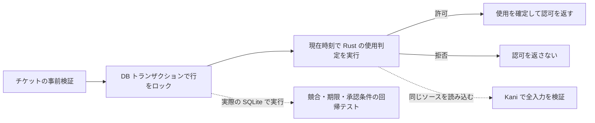

# チケットのセキュリティ検証

`Security invariants` ワークフローは、Pull Request、`main` への push、
および手動実行で次のチェックを実行します。

| チェック | 検証する性質 |
| --- | --- |
| Kani | 有効期限の瞬間に失効し、失効済み・残回数がゼロのチケットは消費できる状態にならない |
| Kani | 短期専用モードは、発行時刻以降で設定上限内の有限期限と残り1回を必要とする |
| Kani | 1回分の消費後、返却を行わない限り同じチケットを次の判定で消費できない |
| SQLite | 事前検証後に有効期限や残回数が変わっても、消費時の状態を使う |
| SQLite | 並行した消費の成功は1回。申請の本人、承認済み、一時アクセスという条件を満たす場合に限って有効化でき、同時に有効化しても発行されるチケットは1枚 |



Kani は実行時に呼ぶ [Rust の判定](../warpgate-common/src/ticket_policy.rs)
を直接読み込みます。固定幅整数と列挙型で表現できる全入力が対象です。
SQLite テストは、その判定を行ロック下で使う処理と申請のトランザクションを
確認します。DB エンジン、暗号実装、SSH の通信処理全体は証明の範囲外です。
分散構成の期限判定は、各 Warpgate ノードの UTC 時刻に依存します。

Linux x86-64 では次のコマンドで CI と同じチェックを実行できます。

```sh
bash security/kani/check.sh
cargo test --locked -p warpgate-core --features sqlite --lib security_invariant
```
