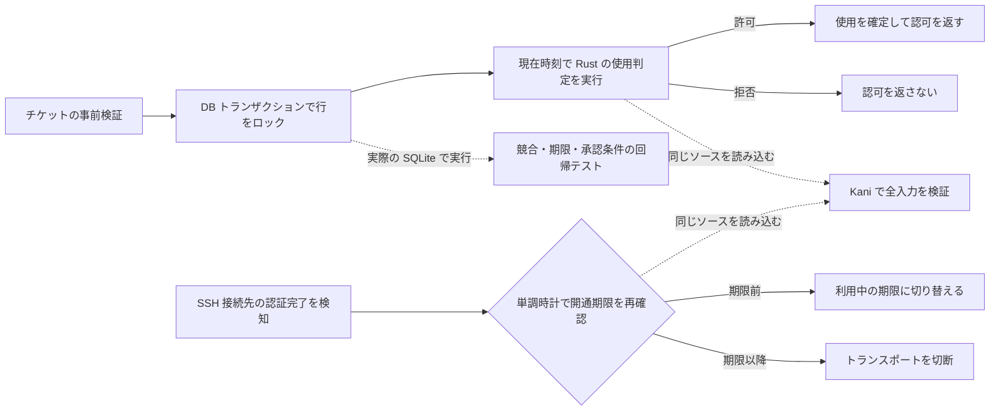

# セキュリティ検証

`Security invariants` ワークフローは、Pull Request、`main` への push、
および手動実行で次のチェックを実行します。

| チェック | 検証する性質 |
| --- | --- |
| Kani | 有効期限の瞬間に失効し、失効済み・残回数がゼロのチケットは消費できる状態にならない |
| Kani | 短期専用モードは、発行時刻以降で設定上限内の有限期限と残り1回を必要とする |
| Kani | 1回分の消費後、返却を行わない限り同じチケットを次の判定で消費できない |
| Kani | 接続先の認証完了を検知した時点が SSH の開通期限以降なら、利用中への切り替えを拒否する |
| Kani | 接続完了イベントが重複しても利用中の期限は延長せず、期限を計算できない場合はエラーにする |
| Kani | MFA ポリシーが TOTP を要求するときは、TOTP と別の有効な認証情報を両方必要とする |
| Kani | ブラウザー承認による MFA には、その承認の検証を必要とする |
| Rust | アカウントの認証ポリシーと MFA を組み合わせ、TOTP 単独を拒否し、検証済みのブラウザー承認を扱える |
| SQLite | 事前検証後に有効期限や残回数が変わっても、消費時の状態を使う |
| SQLite | 並行した消費の成功は1回。申請の本人、承認済み、一時アクセスという条件を満たす場合に限って有効化でき、同時に有効化しても発行されるチケットは1枚 |



Kani は実行時に呼ぶ [チケットの判定](../warpgate-common/src/ticket_policy.rs)、
[SSH の期限遷移](../warpgate-protocol-ssh/src/server/session_deadline.rs)、
[MFA の追加要件](../warpgate-common/src/auth/mfa_policy.rs) を直接読み込みます。
固定幅整数と列挙型で表現できる全入力が対象です。期限遷移には比較だけを使うため、
検証では単調時計の順序を整数で表し、実行時は Tokio の単調時計を使います。
SQLite テストは、その判定を行ロック下で使う処理と申請のトランザクションを
確認します。DB エンジン、暗号実装、SSH の通信処理全体は証明の範囲外です。
分散構成の期限判定は、各 Warpgate ノードの UTC 時刻に依存します。

不変条件を満たさない場合、Kani は失敗した条件と、反例を実行し直すための
Rust テストを CI ログに表示します。すべての検証ファイルを実行し、いずれかが失敗したら
CI のジョブも失敗します。

Linux x86-64 では次のコマンドで CI と同じチェックを実行できます。

```sh
bash security/kani/check.sh
cargo test --locked -p warpgate-common -p warpgate-core --features warpgate-core/sqlite --lib security_invariant
```
